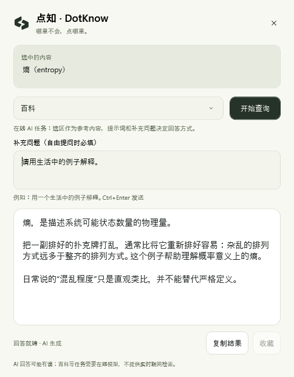
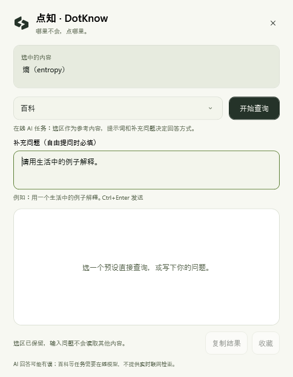
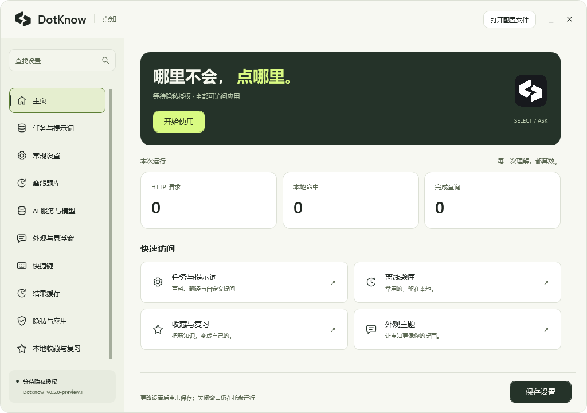
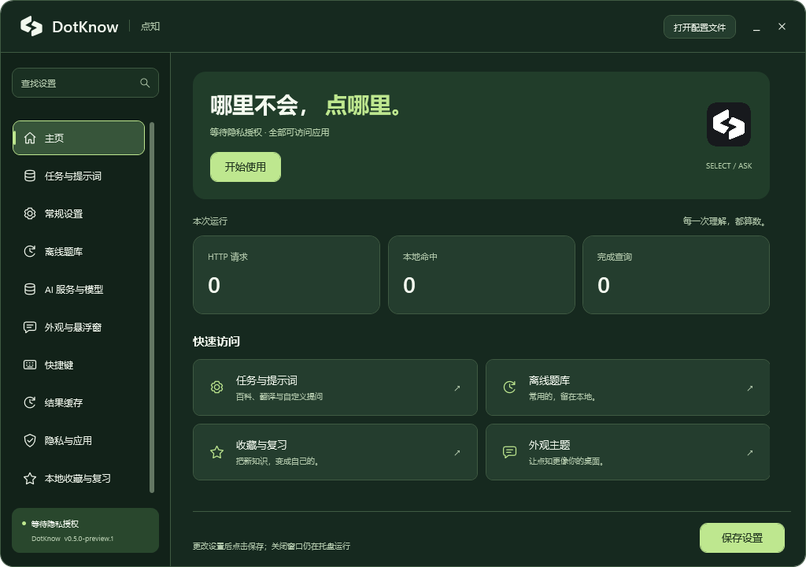
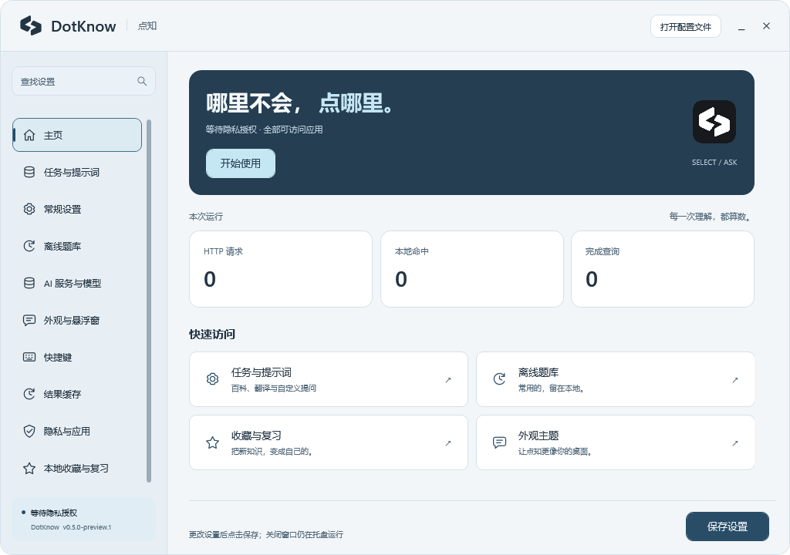
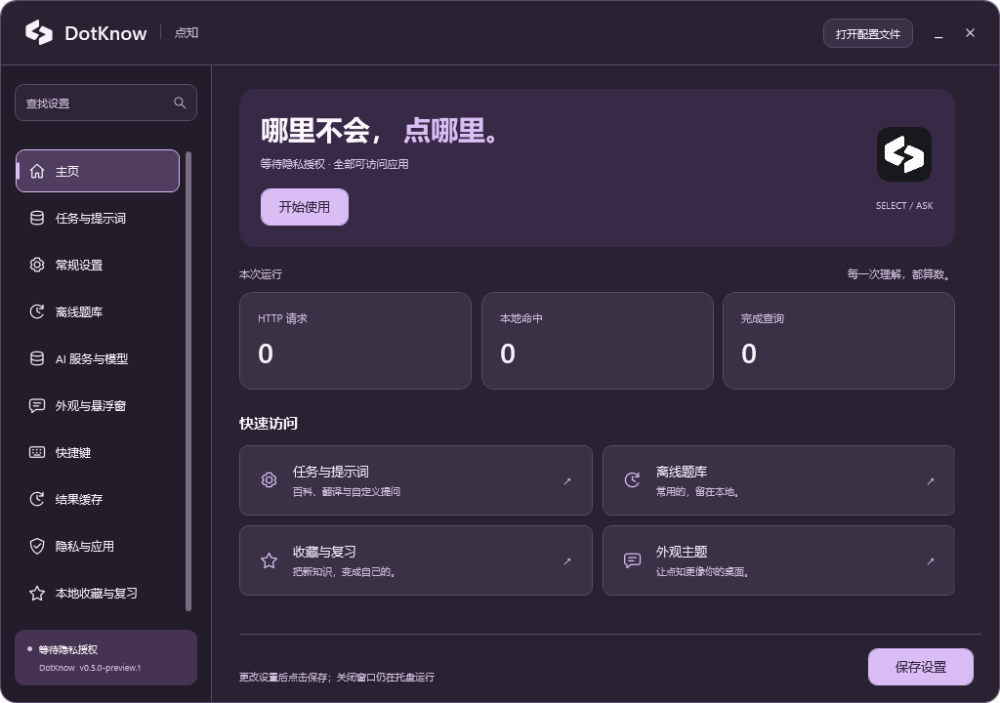

# 点知 DotKnow · 划选即问与多主题

本轮沿用已选定的 C 双向对话图形。主窗口、侧栏、设置卡片、输入控件、收藏与复习、翻译浮窗及托盘菜单共享同一套配色资源；托盘图标仍按 Windows 任务栏明暗选择透明黑／白标。

## 划选即问

新首页使用「哪里不会，点哪里」。侧栏增加任务与提示词，内置百科、翻译、解释、摘要、润色、代码解读和自由提问。新用户划选后先显示任务面板，点击查询才发送；也可直接执行默认预设。译文的紧凑浮窗继续保留。

提问窗口保持原选区，点击问题框后输入；长回答支持选择和滚动，可复制、收藏。它共享官网的浅纸样式及其余主题。下列回答为真实 WPF 验收中的固定示例，不是联网搜索结果或模型能力评测。

| 百科回答面板 | 划选后输入问题 |
| --- | --- |
|  |  |

[任务与提示词](ui-preview/settings-prompts.png) · [自定义模板](ui-preview/settings-custom-prompt.png) · [保留离线翻译](ui-preview/assistant-offline-translation.png)

## 切换外观

1. 打开「外观与悬浮窗」，在顶部选择 **浅纸／深林／雾蓝／暮紫**。
2. 独立选择 **浅色／深色／跟随系统**，共 12 种组合。浅纸的浅色模式与官网的米白、墨绿、荧光绿保持一致。
3. 选择后即时预览，包括已显示的翻译浮窗和托盘菜单。点击底部「保存设置」保留选择；未保存就关闭时，恢复上次保存的外观。

| 配色 | 风格 |
| --- | --- |
| 浅纸 Paper | 官网同款，米白与荧光绿 |
| 深林 Forest | 低饱和的草木绿 |
| 雾蓝 Ocean | 清透的蓝灰 |
| 暮紫 Lavender | 柔和的丁香紫 |

新配置字段为 `Overlay.ColorTheme`，可选 `paper`、`forest`、`ocean`、`lavender`；原有 `Overlay.Theme` 仍是 `light`、`dark` 或 `system`。旧设置没有配色字段时使用浅纸，保留既有明暗模式，不影响词库、收藏或密钥。

## 界面变化

- 首页加入品牌横幅、真实会话统计、任务与提示词／离线题库／收藏与复习／外观主题四个快捷入口。未授权时，主按钮引导至隐私设置。
- 导航以背景和细指示条表达选中状态，字重、边框占位与内边距固定；页面为滚动条预留空间，延续无抖动的切换行为。
- 设置统一圆角卡片、清晰的标题层级和可见键盘焦点。较窄窗口自动将控件排列到说明下方；保存区域固定在底部。
- 收藏与复习采用独立导读卡、条目卡、答案揭示与进度条；题库搜索与编辑使用相同的视觉层级。
- 浮窗保留紧凑形态，加入 C 矢量标志、独立来源标签和操作栏。透明度只改变背景，主题切换同步更新背景与文字，替换仍需确认。
- 中文、英语、日语界面同步补齐新增文案；设置搜索可检索配色名称。

## 验证

核心验证覆盖 12 组外观设置保存／重载、旧配置兼容、明暗跟随、主题搜索、完整资源，以及八组实际色板的主要文字对比度（至少 4.5:1）。核心测试当前为 215 项。

Windows UI 验收已通过 163 项检查：实际遍历四套配色的浅／深色，逐项核对资源、导航坐标、预览不写配置、关闭恢复、保存持久化、已显示浮窗同步更新、紧凑浮窗及小窗口布局；同时验证短屏首页入口完整可见、入口导航、原有替换、真实鼠标划词与 WebView2 流程。[Actions 记录](https://github.com/Linkyyy/TypeLingo/actions/runs/39436094828) 对应源码 `a49f5f3`。Linux 交叉构建与 Windows GUI 验收分别记录在 [VALIDATION.md](VALIDATION.md)。

## 真实 Windows 截图

以下图片来自同一套隔离 UI 测试，未使用用户数据；完整来源与通过状态见 [source.json](ui-preview/source.json)，检查明细见 [ui-validation.txt](ui-preview/ui-validation.txt)。

| 浅纸 · 浅色 | 深林 · 深色 |
| --- | --- |
|  |  |

| 雾蓝 · 浅色 | 暮紫 · 深色 |
| --- | --- |
|  |  |

更多界面：[主题选择](ui-preview/settings-appearance.png) · [收藏与复习](ui-preview/favorites-review.png) · [小窗口布局](ui-preview/settings-small.png) · [紧凑浮窗](ui-preview/overlay-compact.png)。其他浅／深色组合也保存在 [截图目录](ui-preview)。
