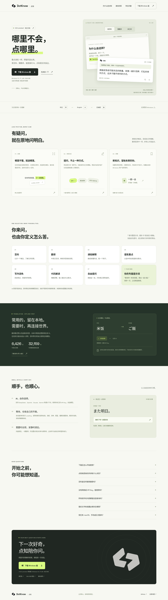

# TypeLingo 官网

沿用 C 双向对话标志，以浅米白、墨绿和荧光绿呈现划词翻译、离线优先、本地收藏与复习。支持手机和桌面。阅读／写作／学习标签、示例复制与收藏、复习卡片、FAQ、移动导航均可操作；交互区域明确标记为示意。

手机效果见 [mobile.png](mobile.png)。

源代码和部署配置位于 [website/](../../website/README.md)。

也可在 Vercel 中导入现有 `Linkyyy/TypeLingo` 仓库，分支选择 `codex/typelingo-favorites-and-replacement`，Root Directory 选择 `website`，Framework 选择 Vite，构建命令 `npm run build`，输出目录 `dist`。网站没有运行时密钥要求。账号部署授权需要由 Vercel 项目所有者提供；以上链接是部署入口，不代表已经上线。

## 下载

Windows 按钮直接连接经过检查的 `0.4.0-preview.6` ZIP，不依赖网站的 JavaScript。安装包保存在不可变 Git commit，文件 SHA-256、大小和下载路径集中在 `website/src/release.js`。

当前 Windows ZIP：68,537,067 字节，SHA-256 `9acd644e0ae57118d03cf50176804b68d2109d72fb7a44d377e098dbbfcebb4a`。本次网络验证返回 HTTP 206、`Content-Type: application/zip` 和有效 ZIP 签名 `PK\x03\x04`。

## 验证

已通过生产构建与 10 项浏览器检查：浏览器交互、320/390/768/1440 px 宽度检查、无 JavaScript 下载检查，以及桌面／移动端 WCAG AA 自动检查。完整命令见源码目录 README。自动检查不能取代人工辅助技术验证。

字体与图标均自托管，没有第三方分析、字体或追踪请求。静态站点可部署到 Vercel 或其他静态托管；安全响应头配置位于 `website/vercel.json`。

## 本次部署状态（2026-10-20）

官网构建完成并已上传 GitHub。Vercel CLI 64.7.0 的正式部署报告没有登录凭据；免登录临时部署报告当前尝试不可用。当前云环境代理访问 `api.vercel.com` 返回 403，常规网络权限申请通过后该独立域名限制仍然存在，因此尚未生成线上地址。

已保存环境配置草稿：增加 `api.vercel.com`、`vercel.com`、`*.vercel.app` 的访问规则，以及只用于 `api.vercel.com` 的 `VERCEL_TOKEN` 密钥需求；草稿尚未应用。若希望由此云环境继续正式部署，请在环境设置中安全填写 Vercel Token，保存设置并发布环境。不要将令牌贴在聊天或提交到仓库。也可以点击上方部署按钮，在自己的 Vercel 账号中导入官网。
